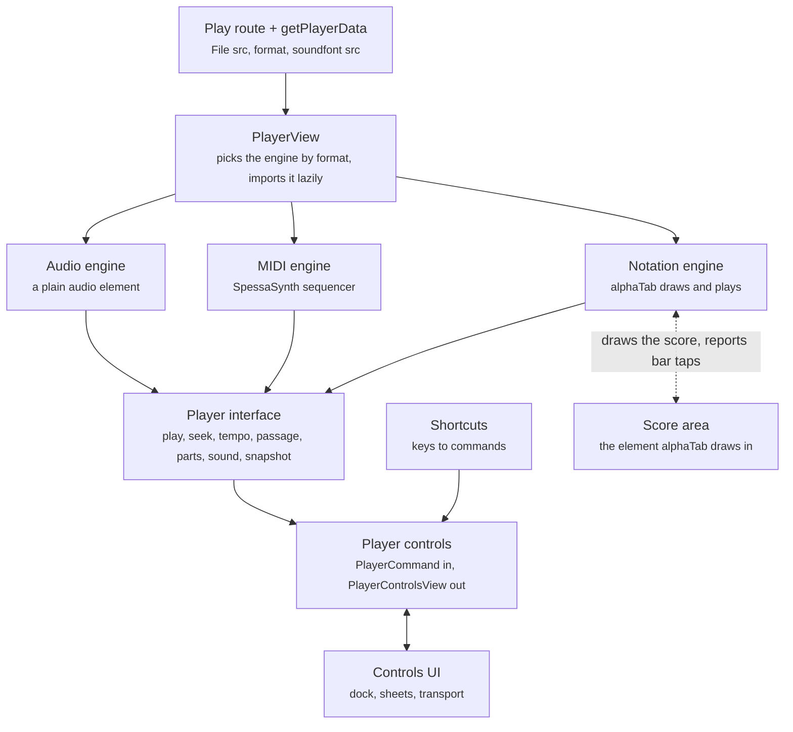
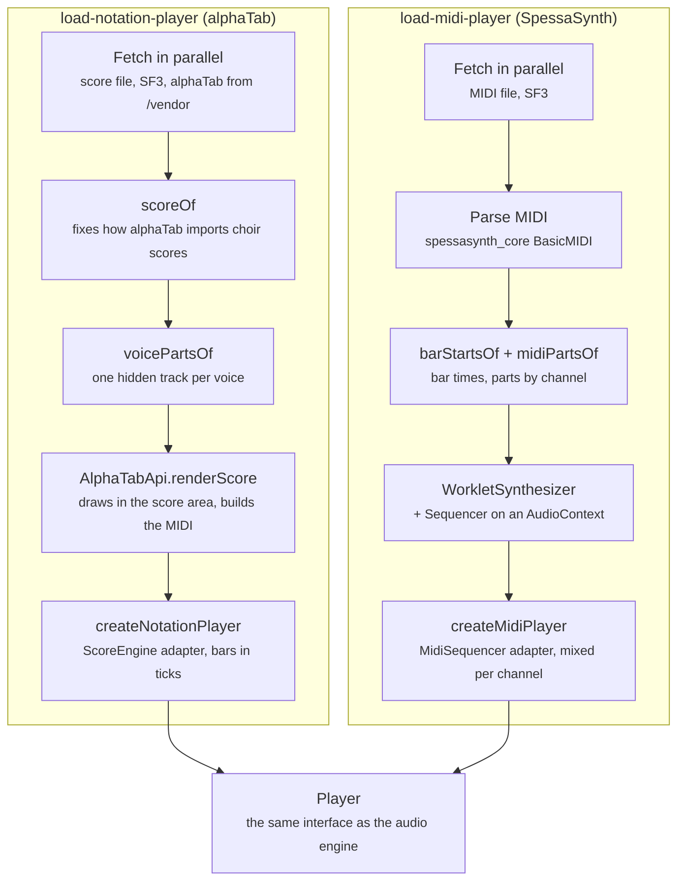

# Player

The player opens a Playable File (see [CONTEXT.md](../../CONTEXT.md)) and plays it. It has three engines, one for each kind of format, behind one `Player` interface. The view and its controls only talk to that interface, so they never know which engine is running. Why there are two music engines is recorded in [ADR-0010](../../docs/adr/0010-the-player-uses-alphatab-for-notation-and-spessasynth-for-midi.md). How MuseScore files become `.mxl` before they reach the player is in [ADR-0009](../../docs/adr/0009-musescore-files-are-converted-by-a-separate-worker.md).

## How the parts fit together

| Layer      | Where                                                                                                         | What it does                                                                                                                                                                                                     |
| ---------- | ------------------------------------------------------------------------------------------------------------- | ---------------------------------------------------------------------------------------------------------------------------------------------------------------------------------------------------------------- |
| Play route | `app/app/[groupSlug]/pieces/[pieceSlug]/play/[fileSlug]/page.tsx`, `lib/pieces/player.ts`                     | Checks that the User can see the Piece, and gives the player the File's URL, its format and the soundfont's URL (`PlayerData`).                                                                                  |
| View       | `components/player/PlayerView.tsx`                                                                            | Uses the format's `engine` (`lib/file-formats.ts`) to start the right engine. MIDI and notation are loaded with dynamic imports, so their libraries are downloaded only when a File that needs them is opened.   |
| Engines    | `audio-player.ts`, `load-midi-player.ts` + `midi-player.ts`, `load-notation-player.ts` + `notation-player.ts` | Each one returns a `Player`.                                                                                                                                                                                     |
| Interface  | `player.ts`                                                                                                   | `Player`, `PlayerSnapshot`, `Passage`, `PlayerPart`, and helpers for bars and passages that work for any engine.                                                                                                 |
| Controls   | `player-controls.ts`, `mix.ts`, `shortcuts.ts`                                                                | Turns UI commands into calls on `Player`, and the player's snapshot into one view object, which React reads with `useSyncExternalStore`. Mix presets and keyboard shortcuts work on that view, not on an engine. |
| UI         | `components/player/controls.tsx`, `desktop.tsx`, `score.tsx`, `useShortcuts.ts`                               | Phone layout below `md`. From `md` up, the wide layout with a waveform or plain strip and keyboard shortcuts.                                                                                                    |

The notation engine also does the drawing. `ScoreArea` only provides an empty element, and alphaTab draws the score into it and scrolls it with the cursor. A tap on a bar comes back through `ScoreEngine.onBarTapped`, and the controls use it to mark a passage. Audio and MIDI Files have no score. On desktop they show a strip instead: a waveform (`waveform.ts`) for audio, a plain bar for MIDI.

## How the music engines load

- **Notation.** alphaTab is imported as a native ES module from `public/vendor/alphatab` and is never bundled, because bundling breaks how it finds its worker and worklet. `scripts/copy-player-assets.mjs` copies it there. `musicxml-score.ts` fixes the parts of real choir scores that alphaTab imports wrongly, and the full list is in ADR-0010. `voice-parts.ts` splits a staff with two voices into hidden tracks, one per voice, because alphaTab mixes per track. `notation-bars.ts` converts between alphaTab's ticks and seconds.
- **MIDI.** `midi-bars.ts` works out from the time signatures when each bar starts. `midi-parts.ts` makes one part per track, and each part is mixed through the channels it plays on.
- **Soundfont.** Both engines read the same trimmed SF3 soundfont from R2 (`soundfont.ts`). Its piano and choir sounds are the player's Piano / Kör switch.

## The adapters, and testing

`createNotationPlayer` and `createMidiPlayer` don't call alphaTab or SpessaSynth directly. They drive narrow adapters, `ScoreEngine` (`notation-player.ts`) and `MidiSequencer` (`midi-player.ts`), and the `load-*` files build those adapters around the real libraries. Seeking, repeating a passage, tempo and mixing are all handled in the `create*` functions, so their tests drive fake adapters (for example `FakeScore` in `notation-player.test.ts`, and `manualFrames` from `lib/testing/player.ts`) and run without a browser or audio. Read [docs/testing.md](../../docs/testing.md) before adding tests here.

Nothing the player does is stored. Every visit starts from the defaults: tempo, passage, mix, sound and the singer's own part (_Min stämma_).
